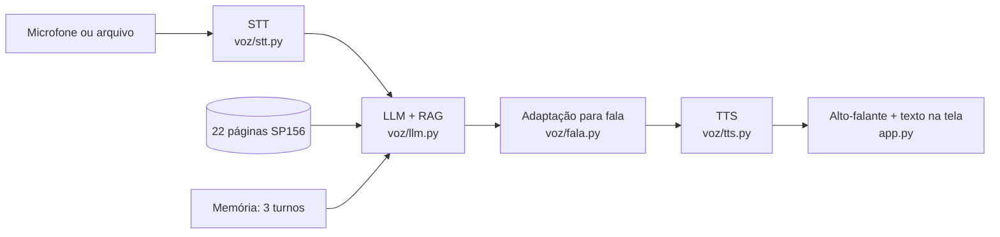

# CitizenTech por voz: assistente de voz para dúvidas de zeladoria urbana

Global Solution 2026.2, disciplina Processamento de Linguagem Natural, Chatbots & Virtual Agents.
Integrante: **Igor Thiago Nakajima Vieira**, RM 563632 (trabalho individual).

O cidadão aperta um botão, fala a dúvida ("qual o prazo para tapar o buraco da minha rua?") e ouve a resposta em
português, que também aparece em texto na tela. As respostas vêm só das páginas oficiais da Carta de Serviços do
portal SP156, da Prefeitura de São Paulo. O assistente lembra a conversa ("e é pago?"), recusa assuntos fora do tema
encaminhando ao órgão certo (SAMU, Defensoria, Polícia) e diz que não sabe quando a base não tem a resposta.

- **Relatório (PDF):** [relatorio/Relatorio_PLN_Assistente_Voz_Igor_Nakajima_563632.pdf](relatorio/Relatorio_PLN_Assistente_Voz_Igor_Nakajima_563632.pdf)
  - problema e persona;
  - ODS;
  - diagrama;
  - justificativas;
  - métricas;
  - LGPD;
  - limitações.
- **Tema vinculado a outra disciplina:** a base de conhecimento e o RAG vêm do trabalho de Generative AI
  ([citizentech-assistente-rag](https://github.com/IgorNakajima11/citizentech-assistente-rag)). O assistente atende o
  mesmo cidadão do projeto CitizenTech de triagem de relatos
  ([citizentech-triagem-web](https://github.com/IgorNakajima11/citizentech-triagem-web)).

## Arquitetura



Cada etapa é um módulo com uma função só (`transcrever`, `responder_turno`, `para_fala`, `sintetizar`), ligados em
`voz/pipeline.py`, que também mede o tempo de cada etapa. Trocar um componente não exige mudar os outros: a tela
deixa escolher entre três motores de STT sem nenhuma outra mudança.

```
app.py                      tela Streamlit: consentimento, microfone, upload, texto, áudio, fontes e latência
voz/stt.py                  STT: Whisper large-v3-turbo (Groq) ou faster-whisper small/base (local)
voz/llm.py                  LLM: recusas direcionadas (saúde, jurídico, violência) + RAG
voz/fala.py                 adaptação para fala: números, datas, valores, telefones e siglas pronunciáveis
voz/tts.py                  TTS: edge-tts, voz pt-BR-FranciscaNeural
voz/pipeline.py             fluxo de um turno e medição de latência
rag/                        busca híbrida (BM25 + embeddings) e geração com citação (do trabalho de Generative AI)
corpus/documentos.jsonl     22 páginas oficiais do SP156 (coletadas em 19/11/2026)
testes/stt/                 20 áudios de teste, frases de referência, planilha e resultados de WER
testes/llm/                 30 perguntas com resposta esperada, planilha e resultados
testes/tts/                 10 respostas sintetizadas e planilha de notas
testes/ponta_a_ponta/       10 conversas de 3 turnos, planilha e latências
scripts/                    página de gravação dos áudios, página de notas do TTS, geração dos áudios sintéticos
relatorio/                  gerador e PDF do relatório
```

## Modelos usados

| Etapa | Modelo / biblioteca | Versão | Licença | Onde roda |
|---|---|---|---|---|
| STT (final) | Whisper large-v3-turbo | API Groq (`whisper-large-v3-turbo`) | MIT (pesos da OpenAI) | nuvem |
| STT (alternativas comparadas) | Whisper small e base via faster-whisper, int8 | faster-whisper 1.2.1, ctranslate2 4.9.0 | MIT | local, CPU |
| LLM | gpt-oss-20b (versão 1 dos testes: gpt-oss-120b) | API Groq (`openai/gpt-oss-20b`) | Apache 2.0 | nuvem |
| Embeddings (RAG) | paraphrase-multilingual-MiniLM-L12-v2 | fastembed 0.9.1 | Apache 2.0 | local, CPU |
| Busca lexical | BM25 | rank_bm25 0.2.2 | Apache 2.0 | local |
| TTS | voz pt-BR-FranciscaNeural (sintética, pronta) | edge-tts 7.3.1 | biblioteca LGPL-3.0; serviço de voz da Microsoft | nuvem |
| Números por extenso | num2words | 0.5.14 | LGPL | local |
| Métrica WER | jiwer | 4.0.0 | Apache 2.0 | local |
| Interface | Streamlit | 1.67.0 | Apache 2.0 | local |

## Como executar

Python 3.10 ou mais novo (testado com 3.14). Não precisa de GPU.

```bash
python -m venv .venv && source .venv/bin/activate
pip install -r requirements.txt
cp .env.example .env              # coloque sua GROQ_API_KEY (https://console.groq.com/keys)

streamlit run app.py              # abre em http://localhost:8501
```

Na tela: aceite o aviso de consentimento, aperte o microfone, fale e aperte de novo; ou envie um arquivo de áudio.
Na barra lateral dá para trocar o motor de transcrição (nuvem ou local). Na primeira vez, os modelos locais
(embeddings e, se escolhido, Whisper) são baixados automaticamente.

### Reproduzir os testes

```bash
python -m scripts.gerar_audios_sinteticos      # gera os 10 áudios sintéticos (os 10 reais já estão no repositório)
python testes/avaliar_stt.py                   # WER dos 3 motores -> testes/stt/planilha_stt.csv
python testes/avaliar_llm.py                   # 30 perguntas -> testes/llm/planilha_llm.csv
python testes/gerar_audios_tts.py              # 10 respostas faladas -> testes/tts/
streamlit run scripts/avaliar_tts_pagina.py    # página para dar notas -> testes/tts/planilha_tts.csv
python testes/avaliar_ponta_a_ponta.py         # 10 conversas de 3 turnos -> testes/ponta_a_ponta/
python relatorio/gerar_relatorio.py            # gera o PDF a partir dos resultados (usa o Google Chrome)
```

Na camada gratuita da Groq há limite de requisições e tokens por minuto. Os scripts esperam e tentam de novo
automaticamente, então a avaliação completa leva alguns minutos.

## Ética e LGPD (resumo)

- **Consentimento antes do primeiro uso:** o aviso diz que a voz vai para a Groq (EUA) no modo nuvem e que o texto
  da resposta vai ao serviço de voz da Microsoft.
- **Retenção mínima:**
  - o áudio é processado em memória e descartado após a transcrição;
  - nada é salvo em disco;
  - o histórico some com "Nova conversa".
- **Dados pessoais:** CPF, telefone e e-mail são mascarados antes do LLM.
- **Limites:**
  - recusa saúde (encaminha para UBS ou SAMU 192), assuntos jurídicos (Defensoria Pública) e violência (190);
  - fora do tema, diz que não encontrou e indica o 156.
- **Alucinação:** só responde com trecho oficial e citação; resposta sem fonte ou com número que não aparece na
  fonte é bloqueada.
- **Voz:** só vozes sintéticas prontas, sem clonagem.
- **Áudios de teste:** os 10 áudios reais em `testes/stt/audios_reais` foram gravados pelo próprio autor, com
  consentimento, só para medir o WER. Os outros 10 são vozes sintéticas.
